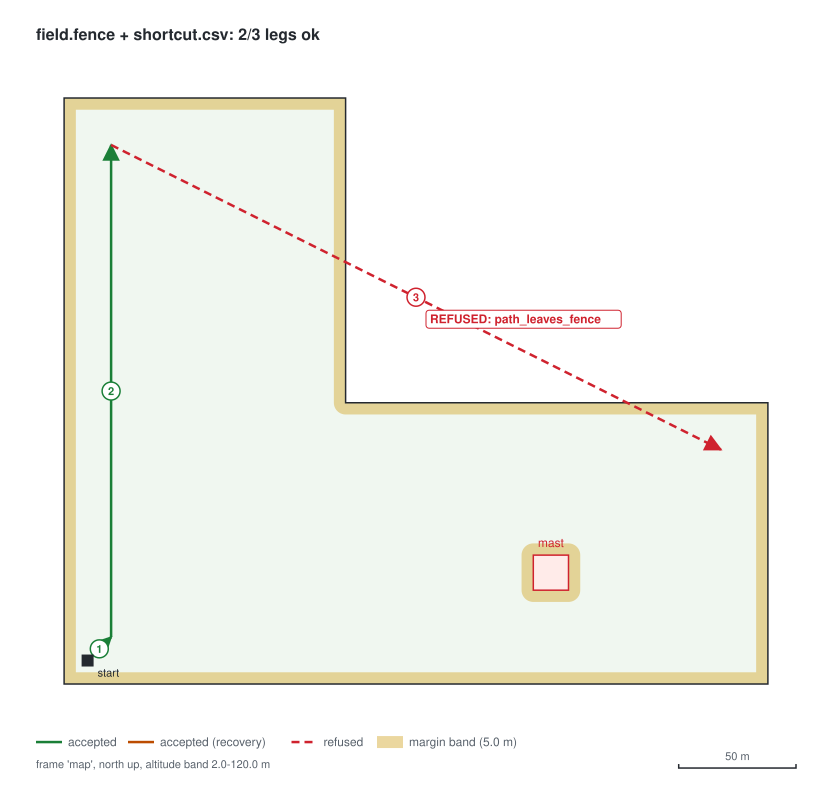
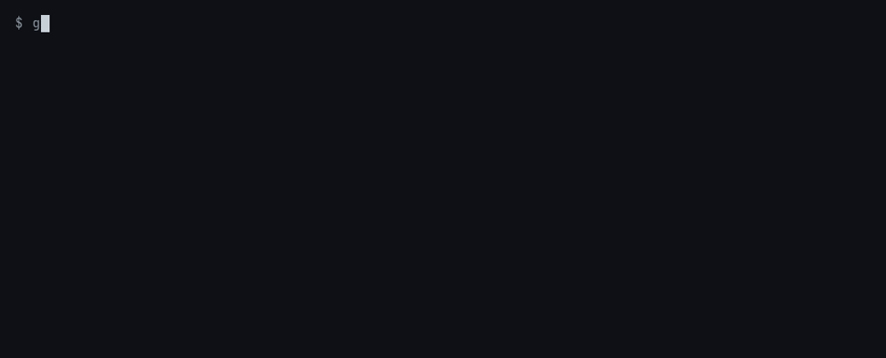
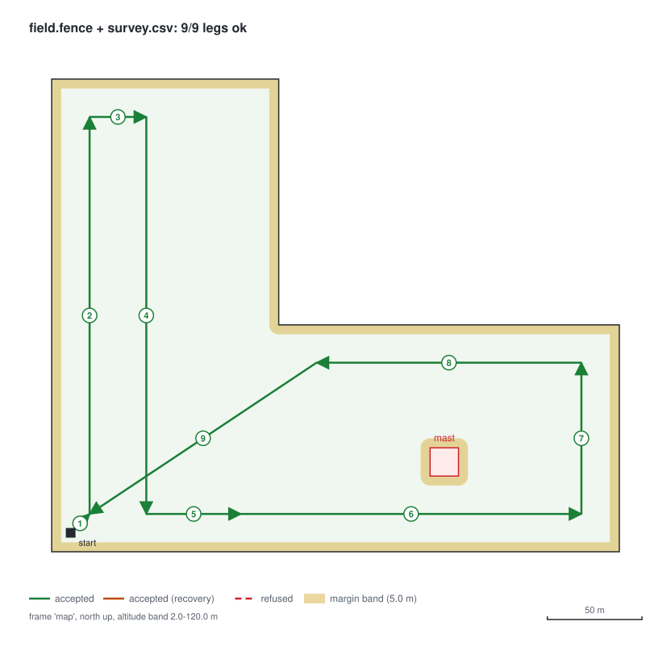
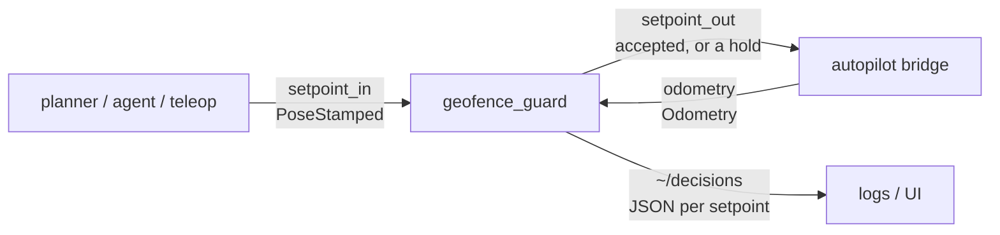

# geofence-guard

[](https://github.com/ahmed-hashim-pro/geofence-guard/actions/workflows/ci.yml) [](LICENSE)

A ROS 2 node that sits between whatever decides where an aircraft should go and
the autopilot that takes it there. It forwards a position setpoint only when it
can show that the move stays inside the flight envelope.

The thing generating setpoints keeps getting less trustworthy. It used to be a
mission file a person checked. Now it's a planner that replans in flight, a
teleop bridge, or a language model with a `goto` tool. Autopilots have geofences,
but they enforce them as a failsafe, *after* the breach: the vehicle crosses the
line, then the autopilot returns to launch. `geofence-guard` refuses the
setpoint before the vehicle moves.

```
$ geofence-guard check examples/field.fence examples/shortcut.csv
leg 1   (10.0, 10.0, 0.0) -> (20.0, 20.0, 30.0)  ok
leg 2   (20.0, 20.0, 30.0) -> (20.0, 230.0, 30.0)  ok
leg 3   (20.0, 230.0, 30.0) -> (280.0, 100.0, 30.0)  REFUSED
        path_leaves_fence: path crosses the boundary of the fence

2/3 legs ok
```

Both ends of leg 3 are inside the fence. The field is L-shaped, though, and the
straight line between the two ends cuts across the missing corner. A check that
only looks at the target accepts this leg. Most of this project exists to handle
that one case and the ones next to it.



*Rendered by `geofence-guard render examples/field.fence examples/shortcut.csv`
from the guard's actual decisions. The shaded band is the 5 m margin a target
or a path may not enter.*

### In PX4 SITL

The same mission, flown twice in PX4 1.15 software-in-the-loop by the same
naive planner. On the left, its setpoints go straight to the autopilot. On the
right, they go through `geofence-guard`. This is Gazebo's own 3D view, recorded
during the flights:


*Recorded from Gazebo Classic's GUI on a virtual display, sped up 4x
([mp4](docs/sitl-gazebo.mp4)). Three things in the picture are not part of
the simulation's physics. The walls and mast are drawn from the envelope file
with no collision, so a vehicle can pass through them as it would through the
real boundary. The blue sphere is a 10 m marker added to the drone's model as
a visual only, because the 0.5 m airframe is a few pixels at this range. The
captions are generated from the flight telemetry. `make sitl-video` records
and composes it again.*

The same two runs as a top-down plot of the logged telemetry:


| | Without the guard | With the guard |
| --- | --- | --- |
| Time outside the fence | **11.8 s** | 0 s |
| Furthest outside | **42.7 m** | n/a |
| Closest approach to the fence | n/a | 8.2 m (margin 5 m) |
| Shortcut leg | flown | refused (`path_leaves_fence`), held 3 s, skipped |

*Measured from the logged odometry of the runs in
[`docs/sitl-results.json`](docs/sitl-results.json), not from what the guard
reported. The animation is drawn from those logs; it is not a screen
recording of the simulator. `make sitl` flies both runs again and re-renders
it, and CI does the same on every push.*

## Quickstart

### The core and the CLI, with no ROS

A C++17 compiler, CMake 3.16+, GoogleTest (`apt install libgtest-dev`).

```bash
git clone https://github.com/ahmed-hashim-pro/geofence-guard.git
cd geofence-guard

make test              # build, then 85 unit and property tests + 8 CLI tests
make check             # the same suite under AddressSanitizer and UBSan

./build/geofence-guard validate examples/field.fence
./build/geofence-guard check examples/field.fence examples/survey.csv
./build/geofence-guard render examples/field.fence examples/survey.csv > survey.svg
```



*Recorded from the real CLI with [VHS](https://github.com/charmbracelet/vhs);
`make demo` re-records it and re-renders the diagrams.*

The core library has no dependencies. Exit codes for `check` are 0 when every
leg passes, 1 when any leg is refused, and 2 when the envelope or mission file
is unusable. `render` draws the same decisions as an SVG, which is the quickest
way to review a mission before it flies:



### The ROS 2 node

You need Docker, not a ROS install:

```bash
make ros    # colcon build + node tests + launch-and-drive smoke test, in ros:jazzy
```

`make sitl` flies the PX4 SITL comparison shown above (Docker only; the PX4
image is about 5 GB).

Or in your own workspace:

```bash
mkdir -p ~/ros2_ws/src && cd ~/ros2_ws/src
git clone https://github.com/ahmed-hashim-pro/geofence-guard.git
cd .. && colcon build --cmake-args -DGFG_BUILD_TESTS=OFF
source install/setup.bash

ros2 launch geofence_guard_ros geofence_guard.launch.py \
    envelope_file:=/path/to/your.fence \
    odometry:=/mavros/local_position/odom \
    setpoint_in:=/planner/setpoint \
    setpoint_out:=/mavros/setpoint_position/local
```

## Where it sits



| Topic | Type | Direction |
| --- | --- | --- |
| `odometry` | `nav_msgs/Odometry` | in: where the vehicle is |
| `setpoint_in` | `geometry_msgs/PoseStamped` | in: where something wants it to go |
| `setpoint_out` | `geometry_msgs/PoseStamped` | out: the accepted setpoint, unchanged, or a hold |
| `~/decisions` | `std_msgs/String` | out: one JSON line per setpoint, with every reason |

```json
{"accepted":false,"recovery":false,"action":"hold","target":[280.000,100.000,30.000],
 "violations":[{"code":"path_leaves_fence","detail":"path crosses the boundary of the fence"}]}
```

## The envelope

```
frame map
margin 5                 # metres kept from every boundary
altitude 2 120           # z, metres
max_state_age 0.5        # seconds
max_leg 300              # optional: metres from the vehicle to any one target

fence                    # keep-in polygon, any simple shape, convex or not
  0   0
  300 0
  300 120
  120 120
  120 250
  0   250
end

exclude mast             # keep-out polygons, any number
  200 40
  215 40
  215 55
  200 55
end
```

The envelope is a prism: a polygon extruded between two altitudes. Exclusion
zones run from the ground to the ceiling, so flying over the mast is refused too.

**An envelope file that could be misread is refused instead of read.** If a
misspelt key were skipped, a limit you wrote down would not be enforced, so
`max_alitude 60` stops the node from starting. Other files that stop the node:

- a key set twice
- a polygon that crosses itself, touches itself, or has zero area
- a zero margin
- a number with trailing units (`5m`)
- `nan`

Numbers are parsed with `from_chars`, so a node started under a decimal-comma
locale reads `2.5` as two and a half, not two. The node won't start without an
envelope, because a guard with no limits looks like protection and gives none.

## The decision

Every setpoint is checked against the vehicle's last known position. All of the
violations are reported, not just the first one.

| Check | Refused as |
| --- | --- |
| Any coordinate or timestamp is NaN or infinite | `non_finite` |
| Setpoint or odometry is in a frame other than the envelope's | `frame_mismatch` |
| The vehicle position is older than `max_state_age` | `stale_state` |
| Target altitude is outside the band | `altitude_out_of_range` |
| Straight-line distance to the target exceeds `max_leg` | `leg_too_long` |
| Target is outside the fence, or within `margin` of its edge | `target_outside_fence` |
| **The path** from the vehicle to the target comes within `margin` of the fence | `path_leaves_fence` |
| Target is inside an exclusion zone or its margin | `target_in_exclusion` |
| **The path** comes within `margin` of an exclusion zone | `path_enters_exclusion` |

The first three end the decision immediately. Once a coordinate is NaN, a
frame is wrong or the position is old, the guard can't reason about anything
else.

### The path, not just the target

The path rule is short: the vehicle starts at least `margin` inside, and every
point on the straight segment to the target stays at least `margin` from every
boundary. A segment can't cross a boundary it never gets within `margin` of, so
this proves the whole leg is safe, target included. The check is exact
segment-to-edge distance. It doesn't sample the path, so a thin spike of
exclusion zone can't slip between two samples.

The autopilot doesn't fly a perfect straight line. The margin is what covers
tracking error, so set it from your vehicle's measured cross-track error, not
from a guess.

### Recovery: getting back from the margin band

The rule above has a trap. Wind pushes the vehicle 2 m from the fence when the
margin is 5 m. Now every path out of that spot starts inside the margin, so
every setpoint is refused, including the one that would bring it back. A guard
that locks the vehicle against the fence is not safe.

So when the vehicle isn't safely inside a region, a different rule applies to
that region, and the decision reports `"recovery": true`:

- The **target** must still be fully safe.
- The **path** may cross the boundary only as often as it needs to on the way
  back: never from inside the margin band, once from outside it. In a
  non-convex fence, a path that comes back in, goes out across the notch and
  comes back in again counts three crossings, and it is refused.

A path that passes exactly through a vertex touches two edges and counts as two
crossings. That's conservative on purpose. The operator can aim a metre to
either side.

### When it refuses

On a refusal, the node publishes a **hold** at the vehicle's position when the
first refusal happened. That hold point stays fixed until a setpoint is
accepted. If it were re-computed from each new odometry message, a stream of
refused setpoints would chase the drift instead of stopping it.

If the guard doesn't know where the vehicle is (no odometry yet, odometry older
than `max_state_age`, or odometry in the wrong frame), it **publishes nothing**.
A hold computed from a stale position could be anywhere. Going quiet lets the
autopilot's offboard-loss failsafe take over, which is what it's for.

Freshness is measured on the guard's own clock, from when the odometry arrived.
It doesn't use the message's header stamp. Autopilot bridges often stamp
messages on a different time base, and a guard that trusted those stamps could
be told that any position is fresh.

## How it is tested

**Property tests against brute force.** 20,000 random worlds are generated, each
with a non-convex fence, an optional exclusion zone, a random margin and a
random move. The guard's decision is compared against a 2,000-step walk along
the actual line.

- **Soundness:** everything the guard accepts, the walk confirms. In normal mode
  no step comes within the margin. In recovery no step leaves after entering.
- **Usefulness:** everything the walk shows has clearance to spare, the guard
  accepts. A guard that refused everything would pass the soundness test and
  fail this one.
- **Recovery applies only when the start really isn't safe.**

The first version of the generator produced almost no safe moves. The suite
went red because the soundness test had too few accepted cases to say anything,
not because the guard was wrong. Both tests now assert minimum counts for every
branch, so a generator change that quietly hollows them out fails the build.

**The node over real topics.** Ten gtest cases run the node in-process against
a harness node. They cover forwarding, the hold and its latching, dropping
before the first odometry, stale odometry, both frame mismatches, NaN
reporting, hold disabled, and refusing to start without an envelope.

**The launched package.** CI starts the installed node with `ros2 launch` in a
`ros:jazzy` container and drives it with `ros2 topic pub`. The node tests prove
the callbacks work. Only a launched process proves the package, the launch file
and the parameter wiring.

The core is built with GCC and Clang with `-Werror`, and the suite runs again
under AddressSanitizer and UBSan.

**In PX4 SITL.** CI flies `sitl/mission.csv` in PX4 1.15 SITL through MAVROS,
twice. The pass condition is about where the vehicle went: every airborne
odometry sample of the guarded run must be inside the fence and outside the
exclusion zone. Two more conditions stop the test from passing for the wrong
reason. The guarded run must have refused something, or it didn't exercise the
guard. And the unguarded control run must leave the fence, or the scenario has
drifted and the guarded result proves nothing.

The first SITL run caught a fault in the test's planner, not in the guard. It
switched to `AUTO.LAND` the moment it came within 2 m of the last waypoint,
still moving fast, and the autopilot's landing overshot to 4.9 m from the
fence, inside the margin. In `AUTO.LAND` the guard has no authority, so the
planner now waits until the vehicle has nearly stopped before handing over.

## What this does not do

- **It has flown in simulation only.** The SITL runs use PX4 1.15 with a
  simulated quadcopter (Gazebo Classic's `iris`) in a world with no wind, one
  mission and one vehicle. On those runs the autopilot tracked the setpoints
  well inside a 5 m margin. A real aircraft in gusts will track worse, and
  nothing here measures by how much. ArduPilot has not been tried.
- **It limits where, not how fast.** Speed, acceleration and attitude limits
  belong to the autopilot (`MPC_XY_VEL_MAX` and similar). The guard trusts that
  the vehicle flies roughly straight between setpoints, within the margin.
- **It works in a local metric frame.** Geodetic fences (lat/lon) have to be
  projected into the same frame as odometry before use. Over a few kilometres
  a local tangent plane is accurate to well under a centimetre horizontally, but
  the Earth curves away from it by about 0.7 m at 3 km, so altitude limits near
  the edge of a large field need that slack. The projection is yours to do.
- **Position setpoints only.** Velocity and acceleration setpoints are not
  checked, so don't route them through the node and assume they were.
- **It is not the last line of defence.** Keep the autopilot's own geofence
  enabled and set slightly outside this one. The guard prevents breaches. The
  autopilot's fence contains the ones that happen anyway.

## Layout

```
core/                 C++17 library + CLI, no dependencies (colcon: plain cmake package)
  include/ src/       geometry, envelope parser, guard
  cli/                geofence-guard validate | check | render
  tests/              geometry, envelope, guard, properties
ros2/geofence_guard_ros/
  src/                the node: subscriptions, hold latch, decision JSON
  test/               node driven over real topics
  launch/ config/
scripts/smoke.sh      launch the installed node and drive it from the ros2 CLI
examples/             field.fence, survey.csv, shortcut.csv
sitl/                 PX4 SITL harness: Dockerfile, run.sh, planner.py, analyze.py,
                      make_world.py + render_video.py for the Gazebo recording
docs/                 README diagrams, demo.gif, sitl.gif, sitl-gazebo.{gif,mp4}
                      (make demo / make sitl / make sitl-video)
```

## License

MIT
